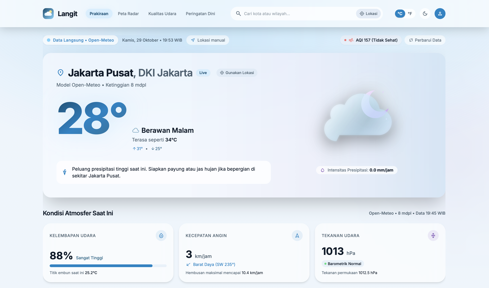
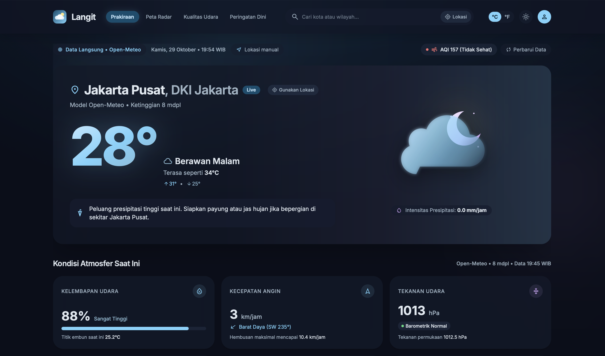
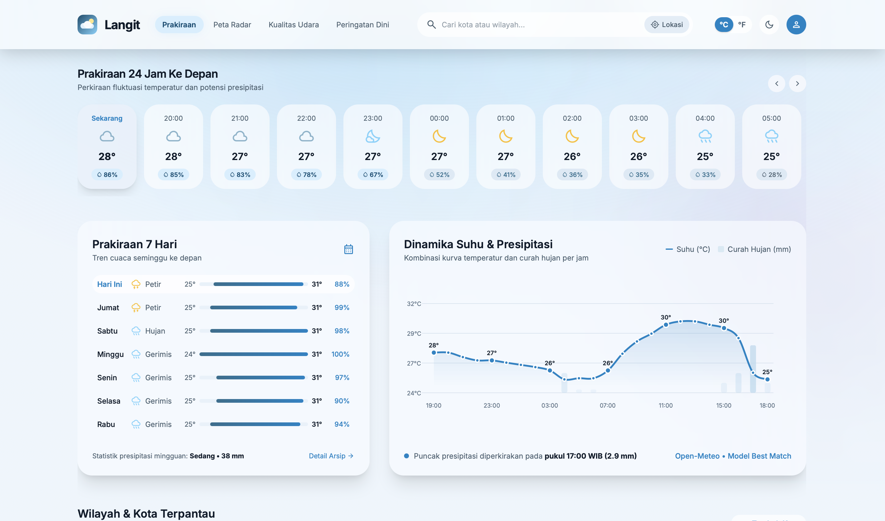
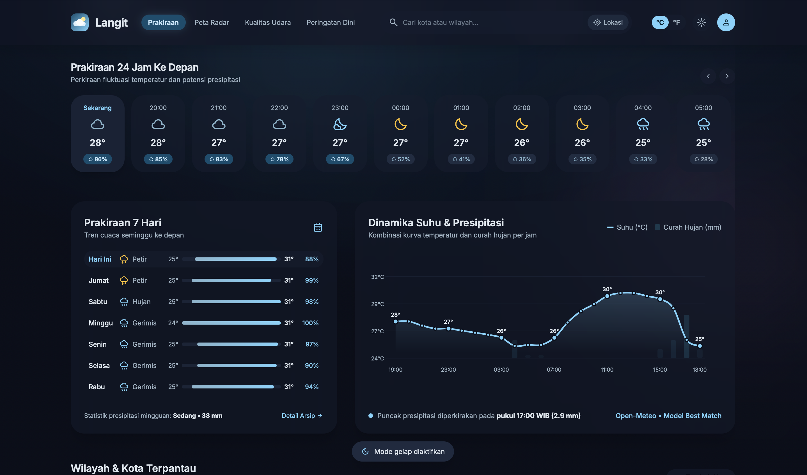

# 🌤️ Langit — Aplikasi Website Cuaca

Website cuaca modern yang menampilkan kondisi cuaca terkini, prakiraan per jam, dan prakiraan 7 hari, lengkap dengan **mode terang (light mode)** dan **mode gelap (dark mode)**.

🔗 **Demo langsung:** [Langit — Weather Web](https://langit-cuaca-nusantara.vercel.app)

---

## 🖼️ Tampilan

Aplikasi mendukung dua tema yang bisa diganti melalui tombol di pojok kanan atas.

| Light Mode | Dark Mode |
|:---:|:---:|
|  |  |

---

## ☁️ Informasi Cuaca

Halaman detail menampilkan informasi cuaca secara lengkap, mulai dari suhu, kelembapan, kecepatan angin, indeks UV, hingga prakiraan cuaca per jam dan 7 hari ke depan.

| Light Mode | Dark Mode |
|:---:|:---:|
|  |  |

---

## ✨ Fitur

- 🔍 Pencarian kota dengan saran otomatis
- 📍 Deteksi lokasi pengguna
- 🌡️ Informasi suhu saat ini, suhu terasa, serta suhu tertinggi dan terendah
- 💧 Detail cuaca: kelembapan, kecepatan angin, tekanan udara, jarak pandang, dan indeks UV
- ⏱️ Prakiraan cuaca per jam selama 24 jam
- 📅 Prakiraan cuaca 7 hari ke depan
- 🌓 Mode terang dan gelap
- 📱 Desain responsif untuk HP, tablet, dan desktop

---

## 🛠️ Teknologi

- **HTML** — Struktur halaman website
- **CSS** — Desain dan tata letak antarmuka
- **JavaScript** — Logika aplikasi dan pengambilan data cuaca
- [Open-Meteo API](https://open-meteo.com/) — Sumber data cuaca
- [Chart.js](https://www.chartjs.org/) — Visualisasi grafik cuaca
- [Vercel](https://vercel.com/) — Hosting dan deployment website

---

## 🚀 Cara Menjalankan

### 1. Clone repositori

```bash
git clone https://github.com/username/nama-repo.git
```

### 2. Masuk ke folder proyek

```bash
cd nama-repo
```

### 3. Jalankan aplikasi

Buka file `index.html` langsung melalui browser.

Atau gunakan server lokal dengan perintah:

```bash
npx serve
```

---

## 📁 Struktur Folder

```text
Langit-Weather-Web/
├── index.html
├── app.js
├── image/
│   ├── DarkMode.png
│   ├── LightMode.png
│   ├── InformationDark.png
│   └── InformationLight.png
└── README.md
```

---

<p align="center">
  <b>🌤️ Langit — Lihat Cuaca, Rencanakan Harimu.</b>
</p>
